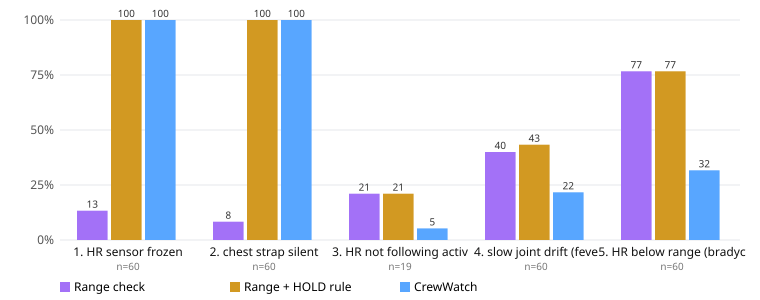

# RESULTS — three detectors, same telemetry, matched false-alarm budget

Generated by `eval/report.py` from `eval/results.json` (`eval/evaluate.py`). Do not edit by hand.

**Setup.** PPG-DaLiA, person-wise split: train S1–S8, validation S9–S11, test (the crew) S12–S15. Faults injected only into test recordings, on top of the real signals. All CrewWatch scores are computed by the integer flight C code (`tinyinfer`) through ctypes.

**Matched budget.** Every detector's threshold is chosen on validation subjects so that at most 0.1 % of normal ticks alarm. Range limits: train min/max widened by k = 0.01 × range (validation FA 0.045 %). HOLD limits (ticks unchanged): hr_x10 ≥ 9, rmssd_x10 ≥ 30.

## Detection rate per injected event

Each cell: detected/n = rate [95 % CI] · *chance* = probability that the same detector alarms at least once in a fault-free window of the same length on clean test data. **A rate is only evidence of detection where it clearly exceeds its chance level.**

| Fault type | n | Range check | Range + HOLD | CrewWatch | median latency (s) R / R+H / CW |
|---|---|---|---|---|---|
| 1. HR sensor frozen | 60 | 8/60 = **13 %** [7–24] · *chance 12 %* | 60/60 = **100 %** [94–100] · *chance 14 %* | 60/60 = **100 %** [94–100] · *chance 3 %* | 300 / 9 / 10 |
| 2. chest strap silent | 60 | 5/60 = **8 %** [4–18] · *chance 12 %* | 60/60 = **100 %** [94–100] · *chance 14 %* | 60/60 = **100 %** [94–100] · *chance 3 %* | 109 / 8 / 3 |
| 3. HR not following activity | 19 | 4/19 = **21 %** [9–43] · *chance 12 %* | 4/19 = **21 %** [9–43] · *chance 14 %* | 1/19 = **5 %** [1–25] · *chance 3 %* | 219 / 219 / 228 |
| 4. slow joint drift (fever-like) | 60 | 24/60 = **40 %** [29–53] · *chance 43 %* | 26/60 = **43 %** [32–56] · *chance 52 %* | 13/60 = **22 %** [13–34] · *chance 26 %* | 588 / 573 / 825 |
| 5. HR below range (bradycardia) | 60 | 46/60 = **77 %** [65–86] · *chance 12 %* | 46/60 = **77 %** [65–86] · *chance 14 %* | 19/60 = **32 %** [21–44] · *chance 3 %* | 50 / 50 / 49 |

[a–b] = 95 % Wilson interval. Detected = at least one alarm tick between onset and end + 60 s.

## Slow drift: size sweep (type 4)

1.0 °C is the sourced case (8.5 bpm/°C); 0.5/2/3 °C are a labelled sensitivity sweep. Chance level for a 3 660-s window: range 43 %, range+HOLD 52 %, CrewWatch 26 %.

| fever-like drift | n | Range | Range + HOLD | CrewWatch |
|---|---|---|---|---|
| 0.5 °C | 28 | 43 % | 54 % | 32 % |
| 1.0 °C | 28 | 46 % | 54 % | 36 % |
| 2.0 °C | 28 | 54 % | 54 % | 39 % |
| 3.0 °C | 28 | 61 % | 61 % | 39 % |

## False alarms on clean test data (realised, not tuned)

| | Range check | Range + HOLD | CrewWatch |
|---|---|---|---|
| alarm ticks / clean ticks | 2.879 % | 2.897 % | 0.346 % |
| per hour (1 Hz) | 103.7 | 104.3 | 12.5 |

28894 clean test ticks (after each person's 1200-s baseline window).

## Integer vs float

Same int16 feature vectors scored by the int8 flight chain and by the float model `||sMx||²`, each at its own validation threshold:

- decision disagreement on clean test ticks: **0.024 %** (7 of 28894)
- decision agreement on validation: 99.992 %

## Model

- F = 9 features → 162-byte int8 weight table (F ≤ 25: same shape class as the board-measured model)
- two instances of the same shape: FAST (1 Hz vector) and SLOW (flight 64-tick window mean, vendor `TLM_WATCH_WindowMean`); integer thresholds 688768 / 771530, each at half the budget

## Which feature led the first CrewWatch alarm (count of events)

- type 1: heart rate HOLD ×59, heart rate RAW ×1
- type 2: chest strap silence (AGE) ×57, skin conductance RAW ×3
- type 3: heart rate RAW ×1
- type 4: skin conductance RAW ×12, heart rate RAW ×1
- type 5: heart rate RAW ×16, skin conductance RAW ×3

## Reading this table honestly

*(Written by hand after looking at the numbers. Rewrite in your own words before using it on a slide.)*

**What the roadmap expected:** types 1–2 caught by the simple rule too, types 3–4 caught only by the
joint model, type 5 fastest with the range check.

**What we measured:**

1. **Types 1–2 (sensor frozen / strap silent):** CrewWatch and the simple "range + HOLD" rule both catch
   **100 %**. The simple rule is as good as CrewWatch here (latency 9 s vs 10 s for frozen HR). For
   silence CrewWatch is faster (3 s vs 8 s) because the AGE feature reacts before any value has been
   unchanged for 9 ticks. The plain range check is at its chance level: blind to both, as on the board
   (316 samples, 0 alarms).
2. **Type 5 (bradycardia, real range violation):** the range check wins clearly (77 % vs 32 %).
   Expected: a single channel leaving its range is exactly what a limit check is for. Earlier we saw
   CrewWatch at 100 % here, but that came from an artefact (the injected plateau was a constant value,
   so HOLD fired). With realistic jitter on the plateau, that advantage went away.
3. **Types 3–4 (HR not following activity, slow fever-like drift):** **no detector does better than
   chance**, CrewWatch included. The fever-like drift sweep stays flat for CrewWatch from 0.5 to 3 °C.
   The roadmap's main hypothesis is **not supported** by this data at 1 Hz. Likely reasons: (a) a wrist
   accelerometer is a weak proxy for exertion (cycling barely moves the wrist while HR is high), so the
   HR↔activity coupling the model would need is weak in the training data; (b) a +8.5 bpm shift is small
   next to the ±50 bpm swings that normal daily activity causes.
4. **False alarms on new people:** with every threshold matched to 0.1 % on validation, on the 4 test
   people CrewWatch alarms on **0.35 %** of ticks (12.5 alarm-seconds/h) and the personal range check on
   **2.9 %** (104/h). One test person's skin temperature and conductance sat outside the range seen in
   training. CrewWatch's per-person feature table absorbs that kind of level shift better. Neither
   detector holds its validation budget exactly, so both rates are worse than tuned.
5. **Integer = float:** decisions differ on 7 of 28 894 clean ticks (0.024 %). The int8 table is not the
   source of the misses.

**What this means for the pitch:** the two layers *do* complement each other, but not in the way the
roadmap guessed. Limit checks handle clear range violations. CrewWatch handles **sensor-health faults**
(frozen or silent wearables, which limit checks cannot see) with a deterministic integer model that
raised fewer false alarms on new people. **Slow physiological drift is not solved by a 1 Hz per-tick
model with these sensors.** We say so, and list it as the next problem (better exertion signal,
e.g. chest-ACC or respiration; longer-horizon features).

**How we got here (iteration log, for transparency):**
- v1: vendor DIFF features → feature means off by 15 000 LSB. Root cause: DIFF has counter semantics
  (D-13). Removed.
- v2: activity/temp/EDA HOLD → natural multi-minute holds dominated validation (D-15). Removed.
- v3: packet-loss spikes in HOLD/AGE set the threshold (all top-0.1 % validation ticks). Rescaled the
  counters and raised the ridge, choosing settings from **validation** diagnostics only (D-17).
- v4: event metric was contaminated by false alarms in long windows → added chance levels; brady
  plateau got jitter (it had been tripping HOLD); range limits made personal so the comparison with
  CrewWatch's personal tables is fair (D-18).
- v5: added the SLOW instance (flight 64-tick window mean) **after** seeing the type 3–5 test results.
  It gave no detection gain (disclosed; it lowered test false alarms from 0.42 % to 0.35 %).
  After v5 the model was frozen. No further changes were made while looking at test numbers.
